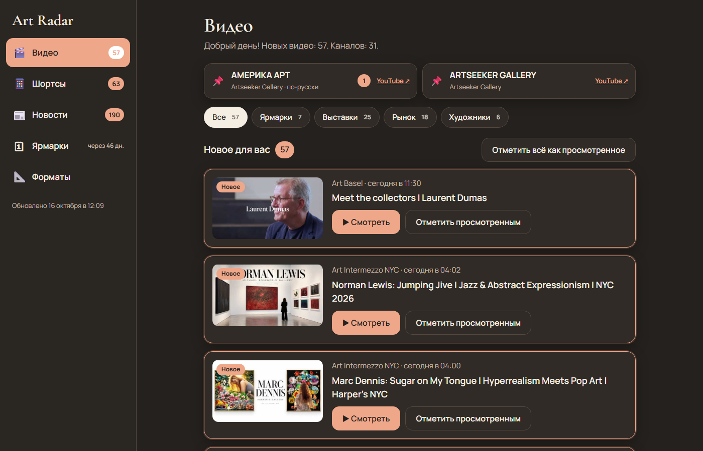
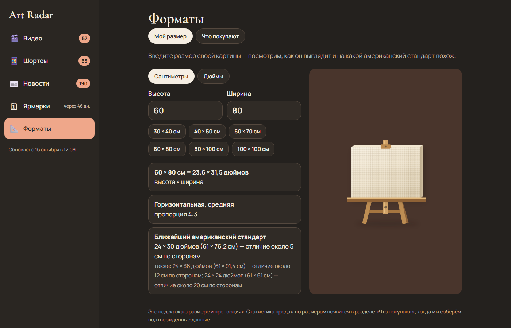
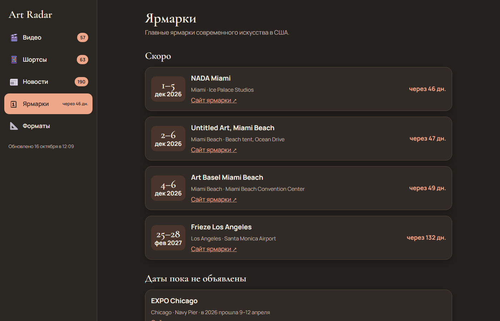

<div align="center">

# Art Radar

**Американский арт-рынок — для художника, на русском языке**

Новые видео о выставках и ярмарках · новости арт-изданий · календарь ярмарок США · какие форматы картин действительно продаются

### [→ Открыть Art Radar](https://yuriykhudov.github.io/art-radar/)

Работает в браузере на компьютере (Windows, Mac) и на телефоне. Регистрация не нужна.

</div>

---



## Что внутри

| Раздел | Что показывает |
|---|---|
| 🎬 **Видео** | Новые ролики 32 YouTube-каналов: обходы выставок в Нью-Йорке, ярмарки, интервью с художниками и галеристами. Первыми закреплены каналы галереи Artseeker |
| 📱 **Шортсы** | Короткие вертикальные ролики тех же каналов — отдельной лентой |
| 📰 **Новости** | Свежие статьи 11 бесплатных арт-изданий: The Art Newspaper, Artnet, Hyperallergic, Artsy, Galerie и других. Издания с платной подпиской и платные разделы не подключаются |
| 🗓 **Ярмарки** | Ближайшие ярмарки США — Art Basel Miami Beach, NADA, Untitled, Frieze — со счётчиком дней |
| 📐 **Форматы** | «Мой размер»: как выглядит ваш холст и на какой американский стандарт он похож. «Что покупают»: какие размеры и техники встречаются среди подтверждённых продаж |

Счётчик «Новое» у каждого свой: браузер запоминает, что вы уже посмотрели.





## Как обновляется

Сайт сам пересобирается **каждый час**: подтягивает новые видео, статьи и даты ярмарок. Правки программы появляются у всех примерно через минуту — достаточно обновить страницу.

## Источники и честность данных

- **Видео** — официальные RSS-ленты YouTube; ролики открываются на YouTube.
- **Новости** — RSS-ленты изданий; статьи открываются на сайтах изданий.
- **Статистика проданных форматов** — только подтверждённые аукционные продажи. Источник: Kangsan Lee et al., *Buying a Work of Art or an Artist? Exploring the Impact of Visual and Social Features on Art Prices*, Springer Nature figshare, 2024, лицензия [CC BY 4.0](https://creativecommons.org/licenses/by/4.0/) — [набор данных](https://springernature.figshare.com/articles/dataset/24746268). Взяты живопись и графика, проданные на аукционах в долларах США (в основном Нью-Йорк), 1984–2015; размеры переведены в сантиметры и сгруппированы по форматам.
- Работа, которая просто исчезла с сайта, **не считается** проданной. Доли и цены показываются, только когда примеров достаточно.

<details>
<summary>Для разработки</summary>

```
python -m radar.app                  # локальная версия с добавлением продаж
python -m radar.build --out _site    # собрать сайт
python -m unittest tests.test_sales  # проверки
```

</details>
